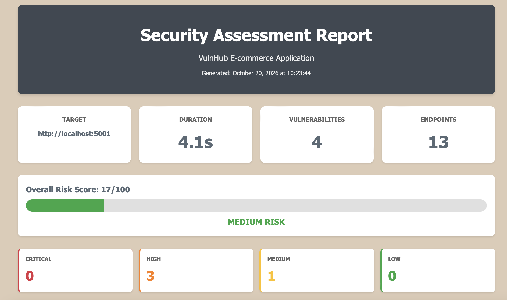

# SafeBuyr — E-commerce Security Platform

[](https://github.com/ChrisCortesSanchez/SafeBuyr/actions/workflows/ci.yml)


A full-stack web security research project that reproduces 6 OWASP Top 10
vulnerabilities in a deliberately vulnerable e-commerce application, pairs each
with a hardened side-by-side implementation, and validates every fix through a
custom 1,200+ line automated vulnerability scanner with an 8-phase assessment
pipeline.

Designed to demonstrate offensive and defensive security skills end-to-end:
exploit development, secure coding, CVSS-based risk quantification, and
automated security validation via CI/CD. The hardened implementation eliminates
every scanner finding — a **100% reduction in application risk score** (32/100
to 0/100).

---

## How This Project Works

SafeBuyr ships as **two fully functional versions of the same e-commerce application** that run simultaneously on separate ports. The vulnerable version exposes every flaw intentionally; the hardened version fixes each one with production-grade controls. The exploit scripts, scanner, and CI pipeline all target both, making the security impact of every fix directly observable.

| | Vulnerable Version | Hardened Version |
|-|-------------------|-----------------|
| **Purpose** | Demonstrates how each vulnerability works and is exploited | Shows the correct, production-grade fix for every issue |
| **Password storage** | MD5 without salt, crackable in seconds | bcrypt with cost factor 12 |
| **SQL queries** | Raw string concatenation, injectable | Parameterized queries via SQLAlchemy ORM |
| **Output encoding** | Jinja2 `\|safe` filter, XSS possible | Automatic escaping, `\|safe` removed |
| **Authorization** | None, any user can access any resource | User ID validation enforced on every endpoint |
| **CSRF protection** | No tokens, state-changing forms unprotected | Flask-WTF tokens on all forms |
| **Security headers** | 0 of 6 headers present | 5 of 6 headers implemented |
| **Risk score** | 32/100 (High Risk) | 0/100 (Low Risk) |

---

## Sample Report Output



---

## Features

- **6 OWASP Top 10 vulnerabilities** reproduced with working proof-of-concept exploits
- **7 exploitation scripts** covering individual attack vectors and a full automated attack chain
- **8-phase vulnerability scanner** with CVSS-based risk scoring and HTML report generation
- **Side-by-side implementations:** vulnerable and hardened versions of every endpoint
- **100% risk reduction** validated end-to-end by the scanner (32/100 to 0/100)
- **Automated CI/CD pipeline:** GitHub Actions running regression tests on every push and pull request
- **Executive-ready HTML reports** with severity breakdowns and remediation guidance

---

## Architecture

```
SafeBuyr/
├── app/
│   ├── app.py                       # Vulnerable Flask app (MD5 hashing, raw SQL, no authz)
│   ├── config.py                    # Configuration
│   ├── models.py                    # Shared SQLAlchemy models
│   ├── templates/                   # Vulnerable Jinja2 templates (|safe filter, no CSRF tokens)
│   ├── data/
│   │   ├── init.sql                 # Schema
│   │   ├── seed_data.py             # Seeds the vulnerable DB with MD5 password hashes
│   │   └── ecommerce.db             # (generated) vulnerable database
│   └── secured/
│       ├── app_secure.py            # Hardened Flask app (bcrypt, ORM, authz, CSRF, headers)
│       ├── templates/               # Hardened templates (output encoding, CSRF tokens)
│       └── data/
│           ├── seed_data_secure.py  # Seeds the hardened DB with bcrypt hashes
│           └── ecommerce_secure.db  # (generated) hardened database
├── exploits/
│   ├── sqli.py                      # SQL injection in product search
│   ├── xss.py                       # Stored XSS via product reviews
│   ├── idor.py                      # Unauthorized order access
│   ├── auth_bypass.py               # Credential attacks: MD5 cracking, username enumeration
│   ├── csrf.py                      # State-changing request forgery
│   ├── cmndi.py                     # OS command injection (demonstration script)
│   └── all_in_one.py                # Full recon-to-exploit attack chain
├── scanner/
│   └── vulnerability_scanner.py     # 1,200+ line 8-phase scanner with HTML/text reporting
├── tests/
│   ├── test_vulnerable_regress.py   # Confirms the vulnerable app stays vulnerable
│   ├── test_secure_regress.py       # Confirms the hardened app blocks each attack
│   └── test_scanner_regress.py      # Confirms the scanner detects what it should
├── docker/
│   ├── Dockerfile.vuln              # Vulnerable app image
│   └── Dockerfile.secure            # Hardened app image
├── examples/
│   ├── reports/                     # Example scanner outputs (vulnerable + hardened)
│   └── screenshots/                 # Scanner report UI screenshot
├── docs/
│   ├── SECURITY.md                  # Secure implementation reference
│   ├── EXPLOITS.md                  # Exploitation walkthrough guide
│   └── SCANNER.md                   # Scanner usage and phase breakdown
├── docker-compose.yml               # Runs both apps together
├── makefile                         # Common run / scan / test / exploit targets
└── requirements.txt
```

---

## Vulnerability Reference

### Vulnerabilities Demonstrated and Fixed

| ID | Vulnerability | Severity | OWASP Category |
|----|--------------|----------|----------------|
| VULN-001 | SQL Injection: product search data extraction | CRITICAL | A03:2021 |
| VULN-002 | Stored XSS: payload injection via product reviews | HIGH | A03:2021 |
| VULN-003 | IDOR: unauthorized access to orders and cart | HIGH | A01:2021 |
| VULN-004 | Weak Password Hashing: MD5 without salt | HIGH | A02:2021 |
| VULN-005 | Missing CSRF Protection: unprotected state-changing actions | HIGH | A01:2021 |
| VULN-006 | Missing Security Headers: no defense-in-depth layer | MEDIUM | A05:2021 |

All six are detected and scored by the scanner. See [docs/SECURITY.md](docs/SECURITY.md)
for the code-level fix behind each one.

### Fixes Implemented

| Vulnerability | Fix Applied | Result |
|--------------|-------------|--------|
| SQL Injection | Parameterized queries via SQLAlchemy ORM | All injection vectors eliminated |
| Stored XSS | Removed `\|safe` filter, automatic output encoding | All user input properly escaped |
| IDOR | Authorization checks enforced on every endpoint | Users can only access own resources |
| Weak Password Hashing | bcrypt with salt, cost factor 12 | Computationally infeasible to crack |
| Missing CSRF | Flask-WTF tokens on all state-changing forms | All requests protected |
| Missing Headers | Comprehensive security header set applied | 5/6 headers implemented |

### Exploit Scripts

Seven scripts in `exploits/` target the vulnerable app by default; run them
against the hardened app to confirm each fix blocks the attack. Full
walkthrough in [docs/EXPLOITS.md](docs/EXPLOITS.md).

| Script | Targets | Notes |
|--------|---------|-------|
| `sqli.py` | VULN-001 | Injection in `/products?search=` |
| `xss.py` | VULN-002 | Stored XSS via product reviews |
| `idor.py` | VULN-003 | Enumerates other users' orders |
| `auth_bypass.py` | VULN-004 | MD5 hash cracking and username enumeration |
| `csrf.py` | VULN-005 | Forged state-changing request |
| `cmndi.py` | — | **Demonstration only:** simulates OS command injection; the app has no command-execution sink, so it is excluded from the scorecard |
| `all_in_one.py` | chain | Automated recon-to-exploit chain |

---

## Scanner Phase Breakdown

The custom vulnerability scanner runs 8 sequential phases against a target URL:

| Phase | Name | What It Tests |
|-------|------|---------------|
| 1 | Endpoint Discovery | Crawls common paths, records reachable endpoints and forms |
| 2 | SQL Injection | Injection payloads against the product search endpoint |
| 3 | XSS Detection | Stored payload injection via product reviews |
| 4 | IDOR Detection | Horizontal access to orders the user does not own |
| 5 | Security Headers | Response header audit (core headers required; HSTS treated as N/A on HTTP) |
| 6 | Authentication Testing | Password-hash strength via login timing, plus login SQLi probe |
| 7 | CSRF Detection | Anti-CSRF token presence on state-changing (POST) forms |
| 8 | Report Generation | CVSS-weighted risk score and HTML/text report output |

See [docs/SCANNER.md](docs/SCANNER.md) for full detail on each phase and the
scoring model.

---

## Installation

**Requirements:** Python 3.9+, pip

**Step 1: Clone the repository**
```bash
git clone https://github.com/ChrisCortesSanchez/SafeBuyr.git
cd SafeBuyr
```

**Step 2: Create and activate a virtual environment**

A virtual environment keeps the project's dependencies isolated from your system.
```bash
python3 -m venv venv
source venv/bin/activate  # On Windows: venv\Scripts\activate
```
You should see `(venv)` appear at the start of your terminal prompt confirming the environment is active.

**Step 3: Install dependencies**
```bash
pip install -r requirements.txt
```

**Step 4: Seed the databases**
```bash
python app/data/seed_data.py                 # Vulnerable version
python app/secured/data/seed_data_secure.py  # Hardened version
```

---

## Usage

The applications use package-relative imports, so run them as modules from the
repository root (not as `python app/app.py`). Open a separate terminal for each
app, then run the scanner or exploits in a third terminal.

**Terminal 1: Run the vulnerable version (port 5001)**
```bash
python -m app.app
# Access at: http://localhost:5001
```

**Terminal 2: Run the hardened version (port 5002)**
```bash
python -m app.secured.app_secure
# Access at: http://localhost:5002
```

> The ports are fixed at 5001 (vulnerable) and 5002 (hardened) — chosen to avoid
> conflicts with Flask's standard port 5000 — so both versions run
> simultaneously without clashing.

**Test credentials:**

| Role | Username | Password |
|------|----------|----------|
| Admin | `admin` | `admin123` |
| User | `user` | `password` |

### Running the Scanner

With the target application running in a separate terminal:

```bash
# Terminal 3: Scan the vulnerable version
python scanner/vulnerability_scanner.py http://localhost:5001

# Terminal 3: Scan the hardened version
python scanner/vulnerability_scanner.py http://localhost:5002
```

**Terminal output against the vulnerable version (abridged):**
```
======================================================================
               VULNERABILITY SCANNER
            VulnHub E-commerce Assessment
======================================================================
Target: http://localhost:5001

[PHASE 1] ENDPOINT DISCOVERY        [+] Discovered 13 accessible endpoints
[PHASE 2] SQL INJECTION DETECTION   [CRITICAL] SQL Injection in Product Search
[PHASE 3] XSS DETECTION             [HIGH] Stored XSS in Product Reviews
[PHASE 4] IDOR DETECTION            [HIGH] Insecure Direct Object Reference in Orders
[PHASE 5] SECURITY HEADERS ANALYSIS [MEDIUM] Missing Security Headers
[PHASE 6] AUTHENTICATION TESTING    [HIGH] Weak Password Hashing (median ~5ms)
[PHASE 7] CSRF DETECTION            [HIGH] Missing CSRF Protection
[PHASE 8] REPORT GENERATION         [+] Report generated in docs/

======================================================================
SCAN SUMMARY
======================================================================
Vulnerabilities Found: 6
  CRITICAL   : 1
  HIGH       : 4
  MEDIUM     : 1
Reports saved to docs/ (HTML report shows Risk Score: 32/100, HIGH RISK)
======================================================================
```

Reports are saved to `docs/` with a UTC timestamp; the HTML report includes the
0–100 risk score and band. Open the HTML file in any browser. Representative
reports for both apps are committed under
[`examples/reports/`](examples/reports/).

### Running the Exploit Scripts

With the vulnerable version running in a separate terminal, run any exploit from a second terminal:

```bash
# Individual exploits
python exploits/sqli.py
python exploits/xss.py
python exploits/idor.py

# Full automated attack chain
python exploits/all_in_one.py
```

All exploit scripts target the vulnerable version by default and accept an
optional target URL as the first argument. Run them against the hardened
version to confirm each fix blocks the attack.

---

## Risk Scoring

The scanner calculates a risk score by weighting each finding by severity and
summing, displayed on a 0–100 scale:

| Severity | Weight |
|----------|--------|
| CRITICAL | 10 |
| HIGH | 5 |
| MEDIUM | 2 |
| LOW | 1 |

The total maps to a band: **LOW RISK** (0–5), **MEDIUM RISK** (6–20),
**HIGH RISK** (21–50), **CRITICAL RISK** (>50).

```
Vulnerable version:  32/100 (High Risk)  — 1 CRITICAL, 4 HIGH, 1 MEDIUM
Hardened version:     0/100 (Low Risk)   — 0 findings
Improvement:           100% risk reduction
```

---

## CI/CD Pipeline

GitHub Actions runs on every push and pull request:

- **Code quality** (advisory): Black formatting, Flake8 linting, and Bandit security linting
- **Regression tests:** seeds both databases, launches each app, and runs three suites:
  - the vulnerable app still exhibits every vulnerability,
  - the hardened app blocks every attack,
  - the scanner detects what it should
- Test logs are uploaded as build artifacts

A `docker-compose.yml` and per-app Dockerfiles are also provided for running
both applications together locally.

---

## Tech Stack

| Tool | Purpose |
|------|---------|
| Python 3.9+ | Core language |
| Flask | Web framework for both vulnerable and hardened apps |
| SQLAlchemy | ORM for parameterized queries in the hardened version |
| Flask-WTF | CSRF token generation and validation |
| bcrypt | Password hashing in the hardened version |
| Docker | Containerized app images (docker-compose for local multi-service runs) |
| GitHub Actions | CI pipeline, runs regression tests on every push and PR |

---

## Roadmap

- [ ] Add JWT authentication vulnerability demonstration (algorithm confusion, none alg)
- [ ] Expand scanner with rate limiting and account enumeration detection phases
- [ ] SSRF demonstration via internal metadata endpoint simulation
- [ ] Interactive HTML report with per-finding remediation expandable panels
- [ ] Scanner output in SARIF format for GitHub Security tab integration

---

## ⚠️ Responsible Use

The vulnerable version contains intentional security flaws for educational purposes:

- Do **not** deploy to production
- Do **not** expose to the public internet
- Run only in an isolated local development environment
- Intended for learning secure coding practices and security testing methodology

---

## Author

**Christopher Cortes-Sanchez** — NYU Tandon School of Engineering, B.S. Computer Science (May 2026)  
Cybersecurity + Mathematics minor | SHPE NYU Tandon  
[GitHub](https://github.com/ChrisCortesSanchez) | cc7825@nyu.edu
